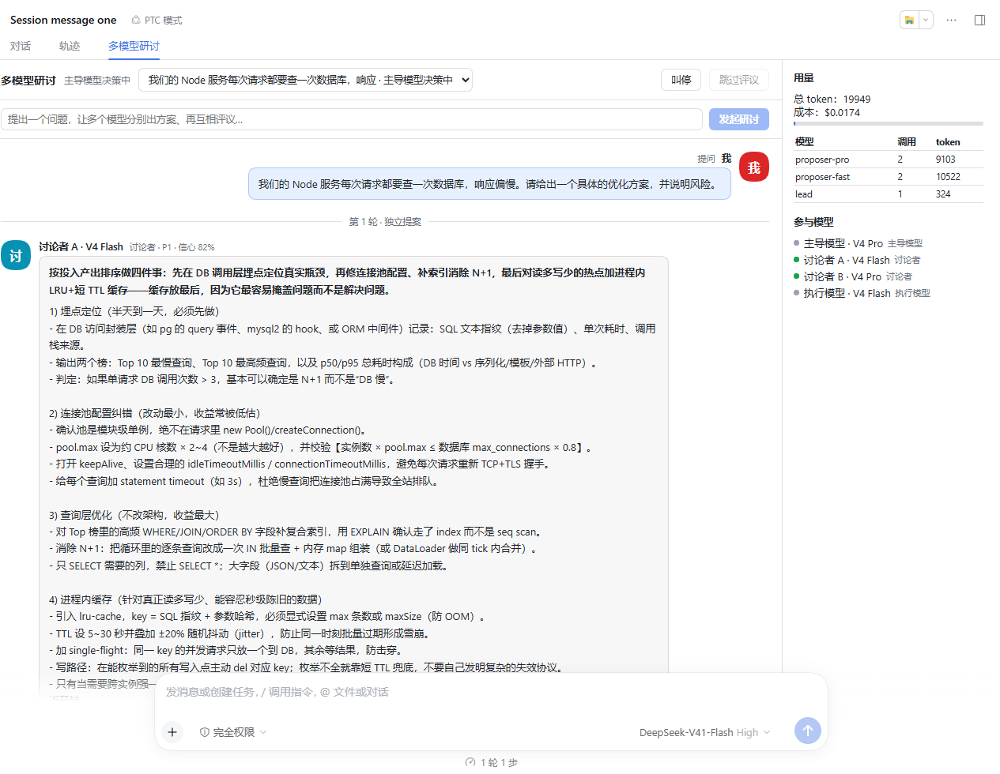
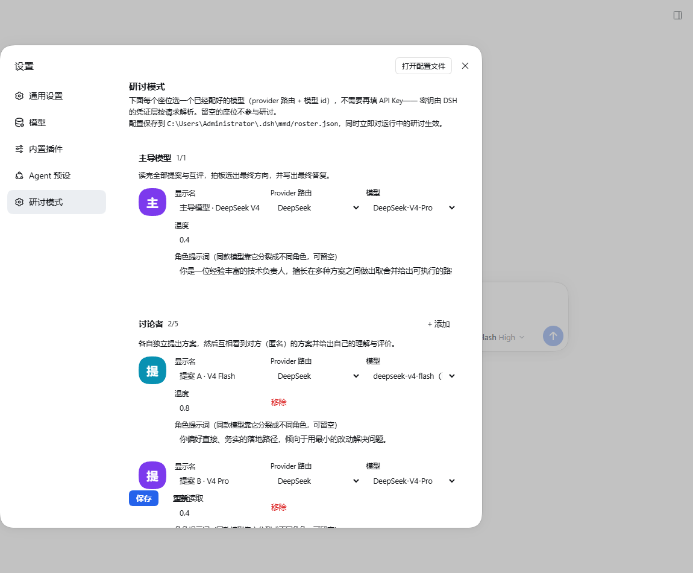

# dsh多轮讨论

**给 [DeepSeek Harness](https://github.com/deepseek-ai/deepseek-harness)（DSH）加一个"多模型研讨"的 agent 预设：多个模型各自独立出方案，互相看到对方（匿名）的方案后逐条评议，再由主导模型拍板融合，最后按你选的执行方式落地。**

不是"让几个模型一起聊天"。角色是分开的，阶段是不可跳的：

```
提问 → 盲提案（每个模型看不到别人） → 互相评议（看到别人的匿名方案，逐条给认可/质疑/建议）
     → 主导模型拍板融合 → 生成执行计划 → 【停下来等你批准】 → 执行 → 汇总答复
```

## 界面

**讨论视图 = 群聊。** 每个角色一个头像气泡，轮次之间有分隔条，右侧是用量与参与模型面板。



**设置 → 研讨模式。** 三类角色各选一个已经配好的模型，点圆形头像就能换图片；下面是执行方式和工具白名单。



## 功能

| 能力 | 说明 |
|---|---|
| agent 预设 | 注册 `mmd-discussion`（显示名「研讨模式」），在「设置 → Agent 预设」里选 |
| 角色座位 | 主导模型 ×1、讨论者 ×1–5、专职评审 ×0–3、执行模型 ×1、验证模型 ×0–2 |
| 直接读已配好的模型 | 设置页从宿主已注册的 provider 路由拉取模型目录（`ctx.llm.listProviders()` / `listModels()`），**不需要再填一次 API Key** |
| 同款模型分裂角色 | 同一个 provider+model 可以坐多个座位，靠 temperature 和角色提示词区分 |
| 头像 | 每个座位可上传 PNG/JPEG/WebP/GIF（≤2 MB），也可以在宿主上直接挑图片文件 |
| 群聊式讨论视图 | 消息流 + 头像气泡 + 轮次分隔 + 用量/成本面板 + 实时状态 |
| 互相评议 | 每个讨论者都会看到别人（匿名，只有 P1/P2 标签）的方案，逐条给出 认可 / 质疑 / 建议 |
| 执行方式可选 | 「执行前先问我」→ 计划涉及状态变更时停下来，界面上出现「批准并执行 / 不执行」；或「直接执行」 |
| 工具白名单 | 执行模型默认**没有任何工具**（只能给步骤说明）；在设置页勾选 `read/write/edit/glob/grep/pwsh/…` 才会真的动手 |
| 预算与成本 | token / 成本 / 时长 / 轮次上限；超限时立即停止讨论、保留已有提案、强制进入决策 |

## 架构

```
~/.dsh/profiles/<profile>/
├── package.json          dsh.profile.bundles 里加 dsh-multi-model-discussion
└── cordis.patch.yml      追加：host 平面工具行 + preset 行（见 preset/cordis.patch.yml）

~/.dsh/mmd/               插件的配置根
├── roster.json           阵容（设置页写这个文件）
├── persona.md            人格契约（批准门禁）
├── skills/               随行技能
└── avatars/              上传的头像
```

插件本体挂在 **host 平面**（提供 HTTP 接口、设置页、讨论视图标签页和 `multi_model_discuss` 工具），
预设只提供 persona 与随行技能。

### 为什么不是"引擎只活在预设里"

原始交付方案的写法是「host 平面那行 `disabled`，引擎只挂在 preset 里」，注释说"disabled 只关引擎行，
不影响客户端分发"。**在 DSH 0.2.0-rc.2 上实测这条不成立**：

1. host 平面那行 `disabled` 之后，插件**不再进入客户端 boot graph**（`window.__DSH_BOOT__` 里找不到），
   设置页与讨论标签页都不会出现；客户端 bundle 的分发依赖一个**处于启用状态的顶层 Loader 条目**。
2. 反过来把插件同时挂在 host 平面和预设里，会因为**同一个包名被两个 Loader 条目解析**而被客户端模块系统
   拒绝（"Distinct active Loader sources resolving to one package name are rejected"），bundle 同样不出现。

### 为什么工具行必须放在 host 平面

执行模型枚举工具是**按当前作用域**看的（`ctx.tools.schemas()`）。DSH 默认把 `tool-fs` / `tool-pwsh`
等工具行声明在**各个 preset 内部**，host 平面的引擎看不到它们 —— 实测表现为执行阶段弹一句
「计划涉及状态变更，但本次没有任何可用工具」，然后整份计划退化成一段文字说明。

因此 `preset/cordis.patch.yml` 把 `read/write/edit/glob/grep/pwsh` 也注册到 host 平面。
这是本仓库相对上游最重要的一处必要补充。

## 安装

前置：已经装好 DSH（桌面版或 CLI 均可）。

```bash
# 1) 安装插件本身（换成你的路径）
dsh plugin --profile <profile> add /path/to/dsh-multi-round-discussion/plugin

# 2) 把 preset/cordis.patch.yml 的内容追加到你的 profile patch 末尾
#    ~/.dsh/profiles/<profile>/cordis.patch.yml
#    注意：用户层 patch 是「按 id 覆盖」语义，新增行必须用 insert: 包裹

# 3) 建立配置根
mkdir -p ~/.dsh/mmd/skills/mmd-workflow
cp config-root/roster.json       ~/.dsh/mmd/roster.json
cp config-root/persona.md        ~/.dsh/mmd/persona.md
cp config-root/skills/mmd-workflow/SKILL.md ~/.dsh/mmd/skills/mmd-workflow/SKILL.md

# 4) 重启 DSH（或在 Web 端刷新页面）
```

自检：

```bash
curl http://127.0.0.1:<端口>/dsh-mmd/handshake
# {"ok":true,"plugin":"dsh-multi-model-discussion","version":"0.1.0","preset":"balanced","enabled":true}
```

### 桌面版的坑

- 桌面版 profile（`--profile desktop`）**不允许用 CLI 启动或 dump**（"managed exclusively by the Electron
  application"），但 `dsh plugin --profile desktop add` 是允许的。
- 客户端 bundle 是在**页面加载时**进 boot graph 的，装完必须**刷新页面或重启应用**才会出现新入口。

## 配置

两种方式，等价：

1. **设置 → 研讨模式**（推荐）：下拉里只有你已经注册好的 provider 路由与模型，选完点保存，
   立即对运行中的研讨生效，同时写回 `~/.dsh/mmd/roster.json`。
2. **直接编辑 `~/.dsh/mmd/roster.json`**：

```json
{
  "profiles": [
    { "id": "lead", "role": "decisionMaker", "provider": "deepseek-account",
      "model": "deepseek-v4-pro", "label": "主导模型", "temperature": 0.4,
      "systemPrompt": "你是技术负责人，负责拍板。" },
    { "id": "proposer-fast", "role": "proposer", "provider": "deepseek-account",
      "model": "deepseek-v4-flash", "label": "讨论者 A", "temperature": 0.8,
      "systemPrompt": "你偏好直接、务实的落地路径。" },
    { "id": "executor", "role": "executor", "provider": "deepseek-account",
      "model": "deepseek-v4-flash", "label": "执行模型", "temperature": 0.1 }
  ],
  "execution": { "mode": "confirm", "allowedTools": ["read", "glob", "grep"], "maxSteps": 12 },
  "peerReview": true,
  "preset": "balanced",
  "avatars": {}
}
```

必需角色：`decisionMaker` + 至少一个 `proposer` + 一个 `executor`。
密钥**永远不写在这里** —— provider 路由由 profile 层注册，密钥由 DSH 的凭证层按请求解析。

## HTTP 接口

| 方法 | 路径 | 说明 |
|---|---|---|
| GET | `/dsh-mmd/handshake` | 探活与版本 |
| GET | `/dsh-mmd/settings` | 阵容 + 执行设置 + provider/模型目录 + 工具目录 |
| POST | `/dsh-mmd/settings` | 保存设置，**同时热应用到运行中的 registry 与 orchestrator** |
| GET | `/dsh-mmd/models` | provider 路由 → 该路由下的模型 |
| GET | `/dsh-mmd/runs` · `/runs/:id` | 运行列表 / 单次运行完整状态 |
| GET | `/dsh-mmd/events` | SSE：运行状态变更流 |
| POST | `/dsh-mmd/runs` | 发起研讨 |
| POST | `/dsh-mmd/runs/:id/control` | `stop` / `skip-review` / `approve-plan` / `force-adopt` / `supply-clarification` / `edit-plan` |
| POST/GET | `/dsh-mmd/avatars` · `/avatars/:key` | 上传 / 读取座位头像 |

所有写接口强制同源校验（`Origin` 与 `Host` 不一致直接 403）。

## 二次开发

浏览器端源码在 `plugin/client-src/`（React + TSX，无构建框架依赖）：

| 文件 | 作用 |
|---|---|
| `index.tsx` | 插件入口：注册 `settings.section` 与 `conversation.view` 两个插槽 |
| `settings.tsx` | 设置页（角色座位、头像、执行方式、工具白名单） |
| `chat.tsx` | 群聊式讨论视图 |
| `avatar.tsx` | 头像（图片 / 首字色块回退） |
| `api.ts` | HTTP + SSE 客户端 |
| `styles.ts` | 运行时注入的样式表 |

```bash
cd plugin
npm install esbuild
npm run build:client      # client-src/index.tsx -> lib/client.js
```

`build.mjs` 里那层 `window.__ModuleLoader__.load({ id, factory })` 封装是必需的：
DSH 把客户端 bundle 当普通 `<script>` 加载，裸 ESM 产物会直接让整个 web boot 失败。

Node 端（`lib/` 除 `client.js`）是上游编译产物，本仓库**未做 TS 化**；改动用 patch 方式维护。

## 已知限制

- **运行态存在内存里**，进程重启即丢失历史研讨。
- **执行模型的写操作未充分实测**：工具白名单、只读工具下的执行链路验证过；`write/edit/pwsh` 的写入路径没有实跑。
- **上游 Node 端没有 TypeScript 源码**：npm 包只发布 `lib/`，`.js.map` 的 `sourcesContent` 缺失，无法反解。
- **成本价格是占位值**：token 数来自 provider 的 `usage`（精确），价格不是；未命中价格表的模型会标为"未定价"而不是按 0 计算。
- 客户端 UI 的插槽名与 API 是**按 DSH 0.2.0-rc.2 的实机源码校对**的；升级 DSH 大版本后可能需要跟着改。

## 来源与许可

MIT。

- **上游引擎**：`dsh-multi-model-discussion` 0.1.0（DSH 官方生态的多模型研讨插件）。本仓库的
  `plugin/lib/`（除 `client.js`）来自它；包含三个必要修复：客户端 bundle 加载格式、
  webserver 服务键名、路由延迟挂载。上游原始说明保留在 `plugin/README.upstream.md`。
- **本仓库新增**：`lib/host/user-settings.js`、`lib/host/settings-routes.js`、
  `lib/host/api-routes.js` 的设置路由挂载、`lib/index.js` 的 roster 装载与设置层、
  `lib/plugins/orchestrator.js` 的**讨论者互相评议**，以及 `client-src/` 全部界面。
